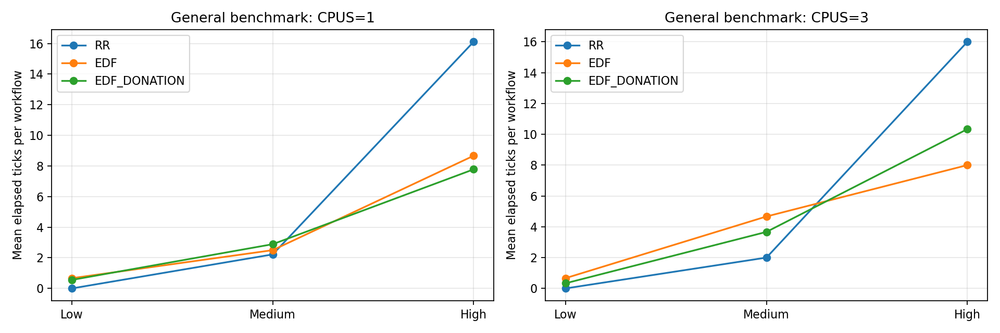
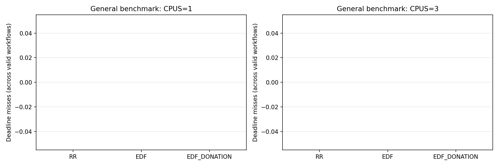

# Scheduler Evaluation Results

Date: 2026-11-13. General sched_bench results are reported separately from the focused donation demonstration.

## Data and validation

Historical CPUS=1 benchmark CSVs and the new one-pass CPUS=1 and CPUS=3 runs were included only when each policy/workload had exactly three distinct workflow IDs (1-3), valid nonnegative elapsed ticks and a successful run summary. Workflow records are not counted as repetitions. A repetition is one complete policy/workload invocation.

| Source directory | CPUs | Complete policy/workload runs |
|---|---:|---:|
| `20261112_224846_031022` | 1 | 9 |
| `20261113_101619_302636` | 1 | 9 |
| `20261113_102920_364650` | 1 | 3 |
| `20261113_104756_383436` | 1 | 9 |
| `20261113_104805_318328` | 3 | 9 |

## General benchmark: actual repetitions

| CPUs | Policy | Low | Medium | High |
|---:|---|---:|---:|---:|
| 1 | RR | 3 | 3 | 3 |
| 1 | EDF | 4 | 4 | 4 |
| 1 | EDF_DONATION | 3 | 3 | 3 |
| 3 | RR | 1 | 1 | 1 |
| 3 | EDF | 1 | 1 | 1 |
| 3 | EDF_DONATION | 1 | 1 | 1 |

Each valid run contributes three workflow measurements. Miss totals below count misses across those measured workflows; means are per-workflow elapsed ticks.

## General benchmark: measured outcomes

| CPUs | Policy | Workload | Valid repetitions | Mean elapsed ticks | Deadline misses / workflows |
|---:|---|---|---:|---:|---:|
| 1 | RR | Low | 3 | 0.00 | 0 / 9 |
| 1 | RR | Medium | 3 | 2.22 | 0 / 9 |
| 1 | RR | High | 3 | 16.11 | 0 / 9 |
| 1 | EDF | Low | 4 | 0.67 | 0 / 12 |
| 1 | EDF | Medium | 4 | 2.50 | 0 / 12 |
| 1 | EDF | High | 4 | 8.67 | 0 / 12 |
| 1 | EDF_DONATION | Low | 3 | 0.56 | 0 / 9 |
| 1 | EDF_DONATION | Medium | 3 | 2.89 | 0 / 9 |
| 1 | EDF_DONATION | High | 3 | 7.78 | 0 / 9 |
| 3 | RR | Low | 1 | 0.00 | 0 / 3 |
| 3 | RR | Medium | 1 | 2.00 | 0 / 3 |
| 3 | RR | High | 1 | 16.00 | 0 / 3 |
| 3 | EDF | Low | 1 | 0.67 | 0 / 3 |
| 3 | EDF | Medium | 1 | 4.67 | 0 / 3 |
| 3 | EDF | High | 1 | 8.00 | 0 / 3 |
| 3 | EDF_DONATION | Low | 1 | 0.33 | 0 / 3 |
| 3 | EDF_DONATION | Medium | 1 | 3.67 | 0 / 3 |
| 3 | EDF_DONATION | High | 1 | 10.33 | 0 / 3 |

## Focused donation demonstration (separate workload)

This controlled test is a four-stage pipe workflow with an unrelated CPU hog. It is not part of sched_bench averages. It was run once for each policy at each CPU count.

| CPUs | Policy | Completed | Elapsed ticks | Deadline | Misses | Donation events |
|---:|---|---:|---:|---:|---:|---:|
| 1 | EDF | 1 | 150 | 100 | 1 | 3 |
| 1 | EDF_DONATION | 1 | 0 | 100 | 0 | 3 |
| 3 | EDF | 1 | 150 | 100 | 1 | 3 |
| 3 | EDF_DONATION | 1 | 0 | 100 | 0 | 3 |

The focused-run records also retain process IDs and donor/pipe/receiver identifiers in `donation_demo_results_separate.csv`; raw QEMU logs remain in their original result directories. Zero elapsed ticks is limited by the xv6 timer resolution and does not mean zero execution time. These single-run observations are not statistical evidence of general policy superiority.

## Deliverables

- `benchmark_results_cpus1.csv` and `benchmark_results_cpus3.csv`: validated combined general benchmark rows.
- `benchmark_results_combined.csv`: both CPU counts with source and repetition fields.
- `donation_demo_results_separate.csv`: focused test data, separate from general benchmark data.
- `general_elapsed_ticks.png`, `general_deadline_misses.png`, and `focused_donation_comparison.png`.
- Original per-run raw logs and CSVs remain preserved under the source directories listed above.
